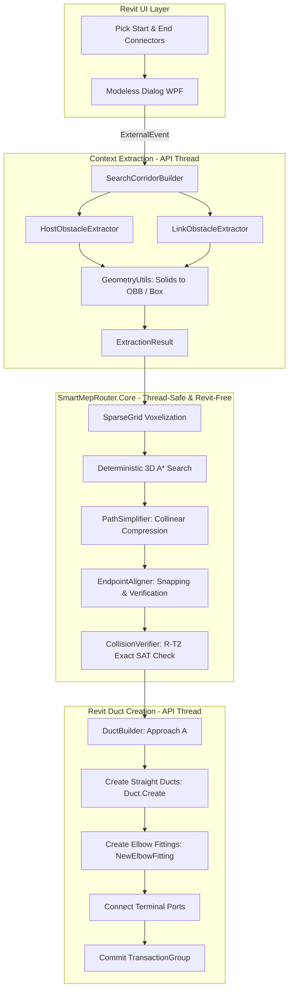

# EaseMEP — Smart MEP Router for Autodesk Revit

<p align="center">
  
  
  
  
  
</p>

---

## 🚀 Overview

**EaseMEP (Smart MEP Router)** is a high-performance compiled C# add-in for **Autodesk Revit** that automatically computes and generates collision-free, fabrication-aware duct routes through complex structural and MEP spatial environments.

Given a start connector (e.g. an AHU discharge) and an end connector (e.g. an air terminal), EaseMEP analyzes the host model and all linked structural/architectural models, plans an optimal rectilinear route respecting fabrication constraints, and instantiates **native, connected Revit ducts and elbow fittings** in a single undoable transaction.

---

## ✨ Key Features

- ⚡ **Fabrication-Aware 3D A\* Search Engine**
  - Custom zero-allocation `MinHeap<T>` priority queue compatible with both `.NET 4.8` and `.NET 8`.
  - Enforces mandatory straight run lengths between fittings (`minRunCells`) and connector stubs (`stubCells`) **directly inside the state space**, preventing unbuildable micro-segments.
  - Collinear compression and 90° bend minimization cost model.

- 🛡️ **Zero-Collision Geometric Guarantee**
  - Dual spatial representation supporting **Axis-Aligned Bounding Boxes (`BoxObstacle`)** and exact **15-Axis Separating Axis Theorem (SAT) Oriented Bounding Boxes (`ObbObstacle`)** for rotated framing, columns, and angled walls.
  - Strict conservative duct & insulation inflation ($clearance + insulation + \frac{\max(w,h)}{2}$) per **FR-17**.
  - Independent segment-level collision verification engine (Rule **R-T2**).

- 🔗 **Full Linked Model Obstacle Coordination**
  - Deep inspection of `RevitLinkInstance` documents with automatic coordinate space mapping (`linkTransform.Inverse`).
  - Seamless handling of rotated or translated structural links without spatial distortion.
  - Diagnostic warnings for unloaded or missing linked models (**FR-05**).

- 🔄 **Atomic Transaction Safety & Undo**
  - All geometry and connectivity changes are wrapped inside an outer `TransactionGroup` with automated rollback on failure (**Rule R-A5**).
  - Integrated `IFailuresPreprocessor` suppressing non-fatal Revit warnings while rolling back cleanly on unrecoverable errors.
  - A failed route never leaves orphaned elements in the user's model.

- 🎯 **Endpoint Alignment & Connector Snapping**
  - Snaps discrete lattice waypoints to exact floating-point connector ports while preserving strict 90° orthogonality and re-verifying obstacle clearance.

- 📊 **Built-In Scientific Benchmark Suite**
  - Headless 50-scene synthetic benchmark testing maze-like obstacles, tight structural gaps, and rotated OBBs.
  - Produces structured JSON run metrics (`RunMetrics.cs`) comparing against plain rectilinear A*.

---

## 🏛️ System Architecture



---

## 📁 Repository Structure

```
EaseMEP/
├── addin/
│   └── SmartMepRouter.addin          # Revit add-in manifest
├── src/
│   ├── SmartMepRouter.Core/          # Pure .NET Standard 2.0 router engine (Zero Revit API references)
│   │   ├── Connectors/               # ConnectorInfo & ConnectorShape DTOs
│   │   ├── Geometry/                 # Vec3, Aabb, Units (decimal feet)
│   │   ├── Metrics/                  # RunMetrics & MetricsWriter (JSON)
│   │   ├── Post/                     # PathSimplifier & EndpointAligner
│   │   ├── Scenes/                   # Synthetic benchmark scene generators
│   │   ├── Search/                   # Deterministic A*, MinHeap, CostModel, Router
│   │   └── Spatial/                  # SparseGrid, BoxObstacle, ObbObstacle (SAT), CollisionVerifier
│   ├── SmartMepRouter.UI/            # Modeless dark-themed WPF interface (net48 & net8.0-windows)
│   │   ├── Themes/                   # Tokens.Dark.xaml (Design token system)
│   │   ├── ViewModels/               # MainViewModel & ObservableObject
│   │   └── Views/                    # MainView.xaml & window-scoped resources
│   └── SmartMepRouter.Revit/         # Revit add-in integration layer (net48 & net8.0-windows)
│       ├── App.cs                    # IExternalApplication (Ribbon Tab & PushButton)
│       ├── Commands/                 # RoutingCommand (IExternalCommand)
│       ├── Creation/                 # DuctBuilder, FailuresPreprocessor, DuctSystemResolver
│       ├── Extraction/               # Host & Link Obstacle Extractors, CorridorBuilder, ConnectorReader
│       └── Preview/                  # ObstacleVisualizer (Debug wireframe shapes)
├── tests/
│   ├── SmartMepRouter.Core.Tests/    # 40 xUnit tests covering math, SAT, A*, and extraction logic
│   └── SmartMepRouter.Bench/         # 50-scene comparative benchmark runner
├── architecture.md                   # Full architectural specification
├── design.md                         # UI tokens and WPF styling guidelines
├── master.md                         # Project index, scope, and glossary
├── memory.md                         # Project decisions, pitfalls, and verified literature
├── phases.md                         # Implementation roadmap and gate criteria
└── rules.md                          # Engineering and anti-hallucination rules
```

---

## 📊 Benchmark Scoreboard

Evaluated across **50 procedurally generated obstacle scenes** containing structural columns, deep beams, floor boundaries, and rotated obstacles:

| Metric | SmartMEP (Fabrication A\*) | Plain A\* Baseline | Improvement / Note |
|---|:---:|:---:|:---:|
| **Scenes Evaluated** | **50** | 50 | Full benchmark set |
| **Solved Routes** | **50 (100%)** | 50 (100%) | **100% completion** |
| **Total Collisions** | **0** | N/A | **Zero collisions verified** |
| **Average Bend Count** | **3.64** | 4.04 | **~10% fewer fittings** |
| **Average Path Length** | **50.32 ft** (15.3 m) | 46.32 ft (14.1 m) | Planned detour around obstacles |
| **Average Search Time** | **29 ms** | 1.2 ms | Real-time response (< 0.1 s) |

---

## 🛠️ Build & Installation

### Prerequisites
- **.NET 8 SDK** (8.0.400+) installed.
- **Autodesk Revit 2024, 2025, 2026, or 2027**.

### 1. Build Solution
```powershell
# Restore and compile across both net48 and net8.0-windows targets
dotnet build SmartMepRouter.sln -c Debug
```
*Note: A post-build target automatically copies assemblies and `SmartMepRouter.addin` into `%APPDATA%\Autodesk\Revit\Addins\2027\` (or `2024`).*

### 2. Run Automated Unit Tests
```powershell
dotnet test SmartMepRouter.sln
```
Output:
```
Passed! - Failed: 0, Passed: 40, Skipped: 0, Total: 40 (net8.0)
```

### 3. Run Benchmark Suite
```powershell
dotnet run --project tests/SmartMepRouter.Bench
```

---

## 🧭 Roadmap & Progress

- [x] **Phase 0 — Environment & Multi-Target Skeleton** (`net48` & `net8.0-windows`)
- [x] **Phase 1 — Core Router & Fabrication A\*** (Deterministic 3D grid, turn penalties, stubs)
- [x] **Phase 2 — Spatial SAT Obstacles & 50-Scene Benchmark** (OBB SAT, CollisionVerifier, JSON metrics)
- [x] **Phase 3 — Revit Ribbon, Command & Modeless WPF Dialog** (Deployed to Revit 2027)
- [x] **Phase 4 — Context Extraction** (Host & Linked model extraction, OBB conversion, connector reader)
- [x] **Phase 5 — Duct Creation & Atomic Rollback** (Approach A `Duct.Create` + `NewElbowFitting` pipeline)
- [ ] **Phase 6 — Interactive UI & Real-Time Preview** (Pick connectors via ExternalEvent, preview graphics)
- [ ] **Phase 7 — Advanced Fabrication Constraints** (45° offsets, minimum straight run rules)
- [ ] **Phase 8 — Hardening & Failure Diagnostics** (Root-cause blocking element ID reporting)
- [ ] **Phase 9 — Paper & Evaluation Gate** (Real Revit MEP project benchmarks)
- [ ] **Phase 10 — Packaging & Demo** (Installer, sample models, video demonstration)

---

## 📜 License & Compliance

Designed and built under clean-room engineering rules.
- **Rule R-A1**: Core contains zero Revit API dependencies.
- **Rule R-A3**: Decimal feet internally; unit conversion strictly at UI boundaries.
- **Rule R-A5**: Atomic transaction integrity with full rollback on error.
- **Rule R-T2**: Strict independent geometric collision verification.
